<div align="center">

# 🛡️ Bastion (PS3 edge AI scam guard)

### *The offline AI guard on your edge device.*

**Scam SMS and phishing-link detection that runs entirely on an Arm board, explained in plain English by Llama 3.2 on ExecuTorch.**
No cloud. No telemetry. Nothing leaves the device.


*Bharat AI-SoC Challenge 2026-27 (Arm) · PS3: On-Device Threat, Phishing & Scam Detection · Team Citadel*
*(Not related to Microsoft's "Azure Bastion".)*

📄 **[Final Project Report (PDF)](docs/Bastion_Final_Project_Report.pdf)**: methodology, results, hardware utilisation, optimisation techniques and Phase 2 targets.

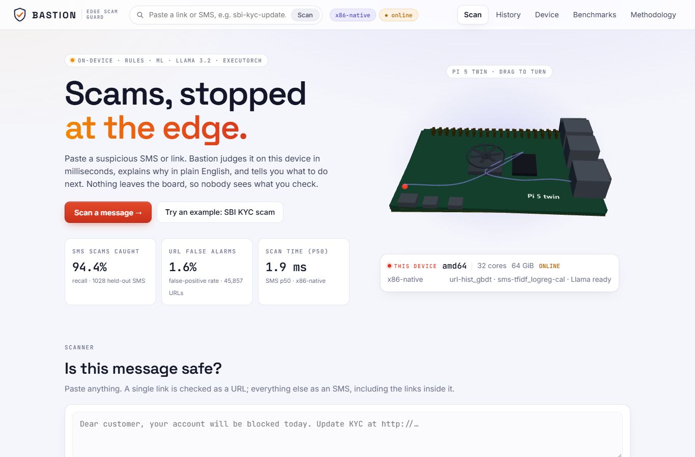

<sub>Real screenshots of the running app; every number on the page is read from the result JSONs in <code>benchmarks/results/</code>.</sub>

</div>

---

## ✨ What it does

Paste a link or an SMS. In milliseconds Bastion gives you:

| | |
|---|---|
| 🚦 **A verdict** | `SAFE` / `SUSPICIOUS` / `MALICIOUS` with a 0-100 risk score and calibrated confidence |
| 🔍 **The why** | the exact warning signs it found (threats, KYC/OTP bait, look-alike domains, raw IPs, links inside the SMS…) |
| 🧠 **A plain-English explanation** | written by **Llama 3.2 1B running on the Arm CPU through ExecuTorch**, streamed live |
| ✅ **What to do next** | block, report (1930 / cybercrime.gov.in / 1909), verify, freeze your account |

> **The detector decides. Llama only explains.** The LLM never sees the verdict as negotiable and can never change it.
> A guard checks every token *while it streams* and aborts the moment the text contradicts the verdict or invents a link
> or phone number, so unsafe text never reaches the screen. (`explain/guard.py`, `pipeline.py`, covered by tests.)

## 📸 Screenshots

| 🔎 A scam SMS, judged in milliseconds | 📱 On a phone |
|---|---|
| 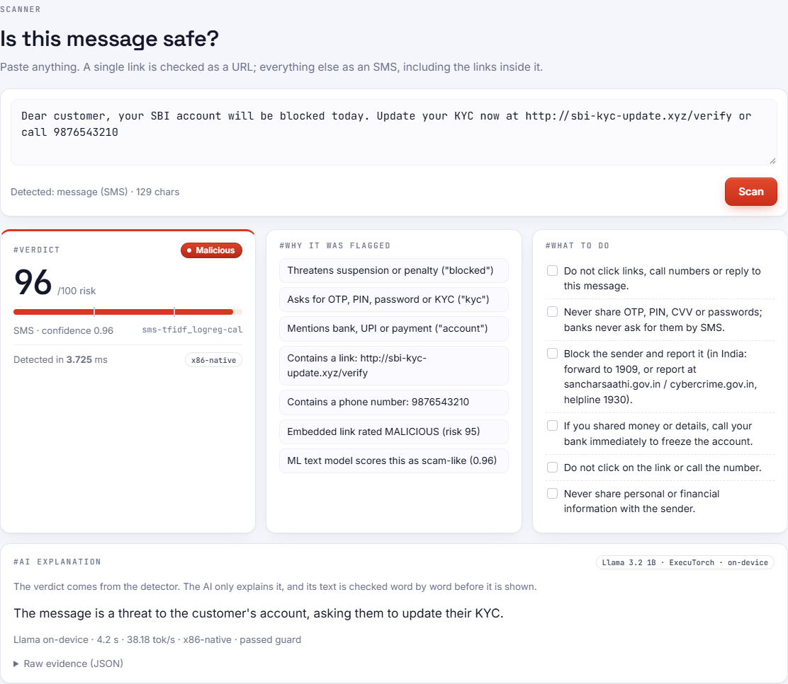 | 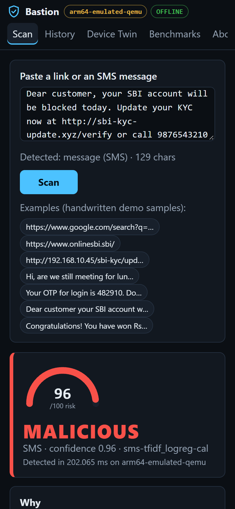 |

| ✅ A genuine link stays SAFE | 🍓 Raspberry Pi 5 twin (3D, live) |
|---|---|
| 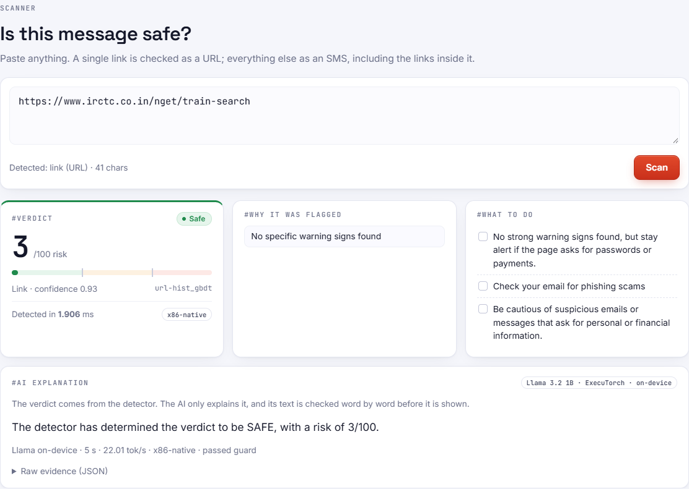 | 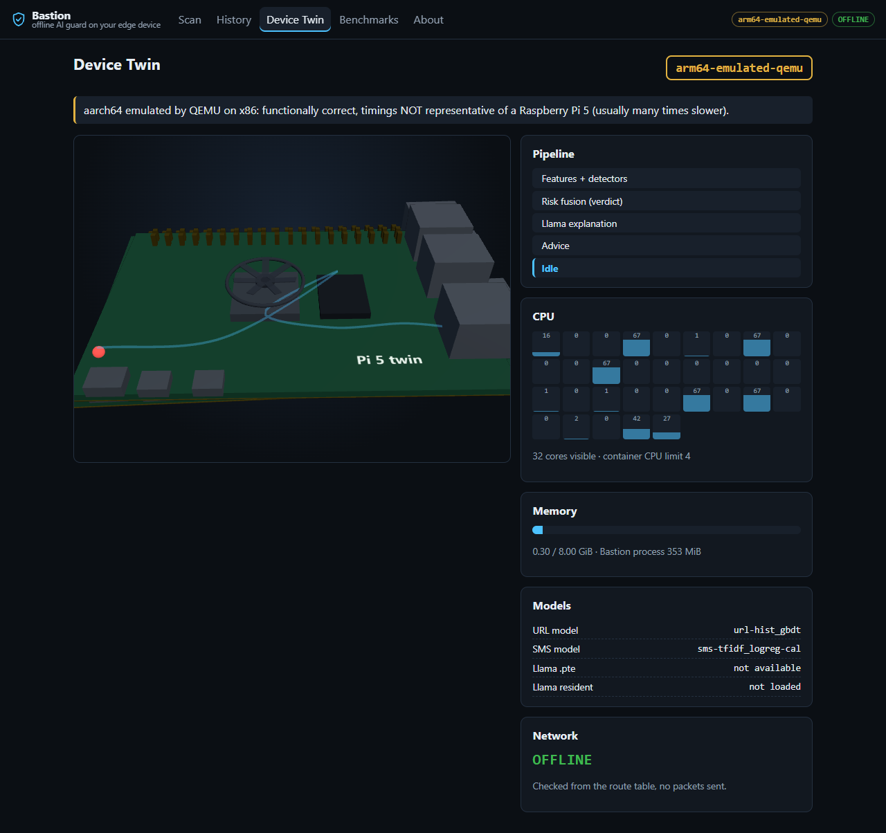 |

| 🖱️ Hover any part: what it does for Bastion | 📱 Explore in 3D on a phone |
|---|---|
| 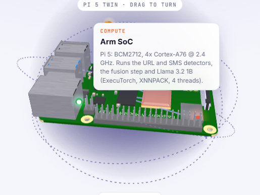 | 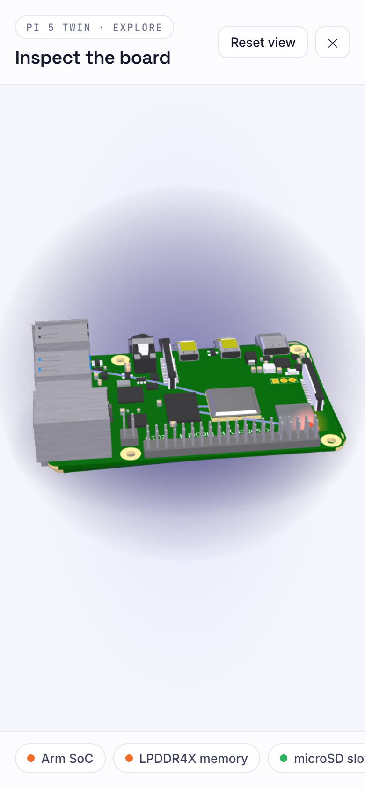 |

**Explore in 3D:** a full-screen board you can rotate, tilt and zoom (pinch, scroll or keyboard). Click a part or a chip to fly to it:

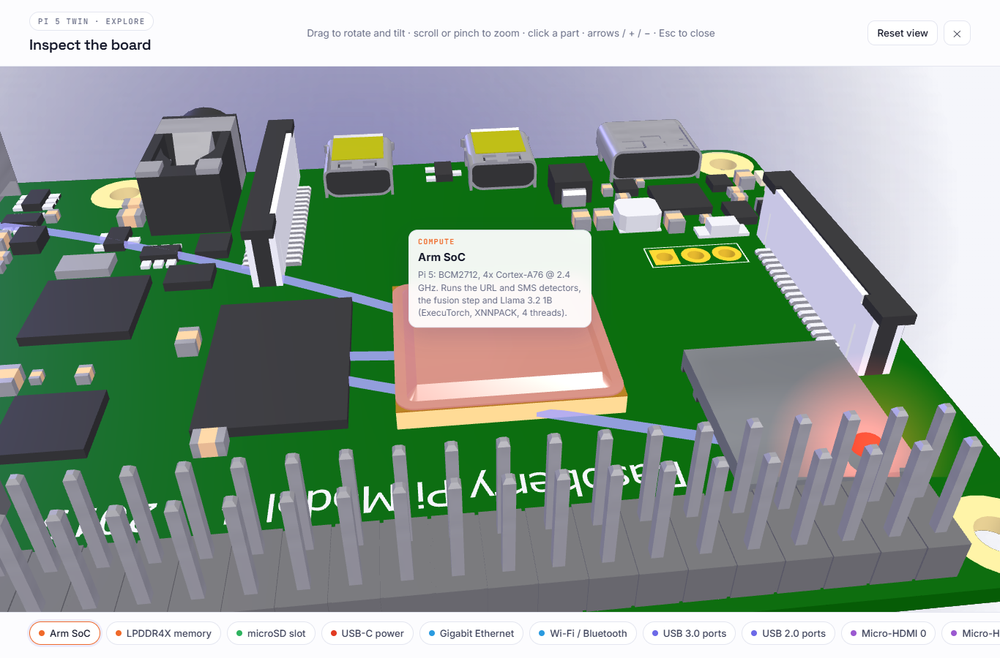

<sub>The 3D model is a Raspberry Pi 4B assembly used as a stand-in for the Pi 5. The part labels describe the Pi 5 (see <code>src/bastion/web/vendor/README.md</code>).</sub>

| 📊 Honest benchmarks | 🕘 Local history |
|---|---|
| 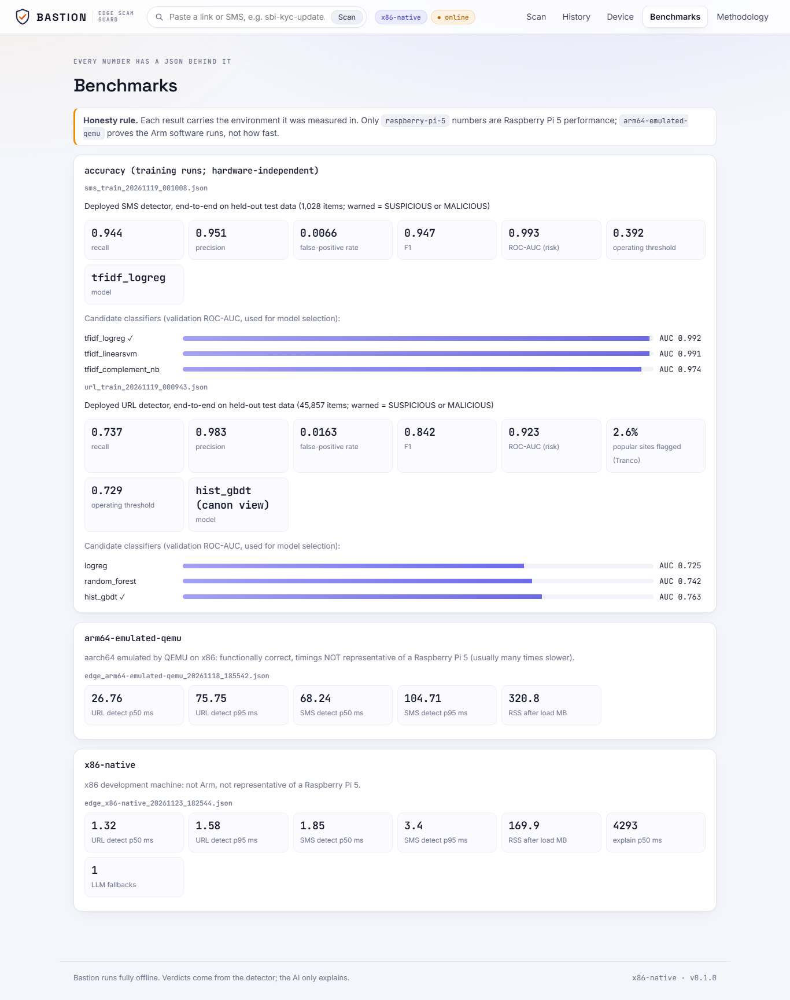 | 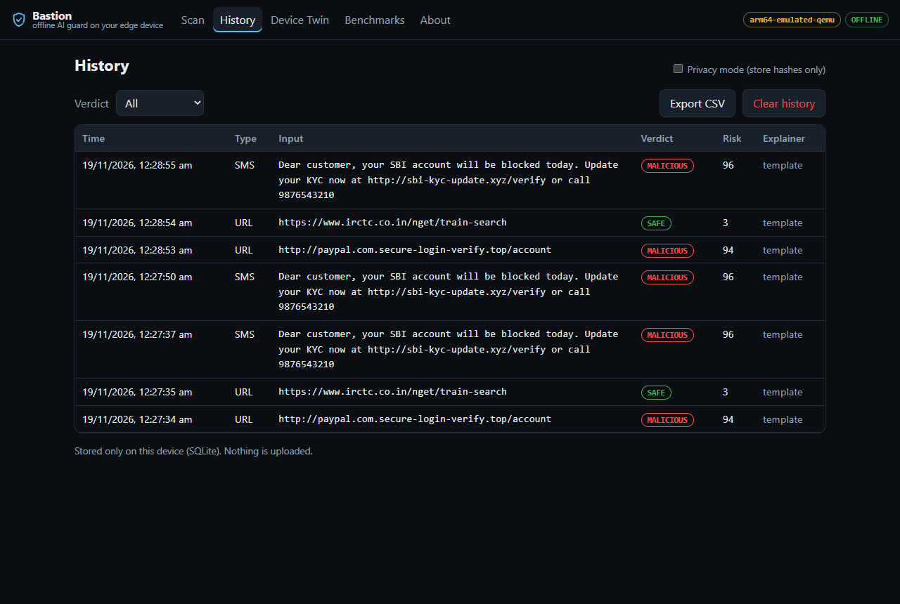 |

**The twin, proven from the terminal:** `uname -m` = `aarch64`, Pi 5 limits, **no route to the internet**, real verdicts:

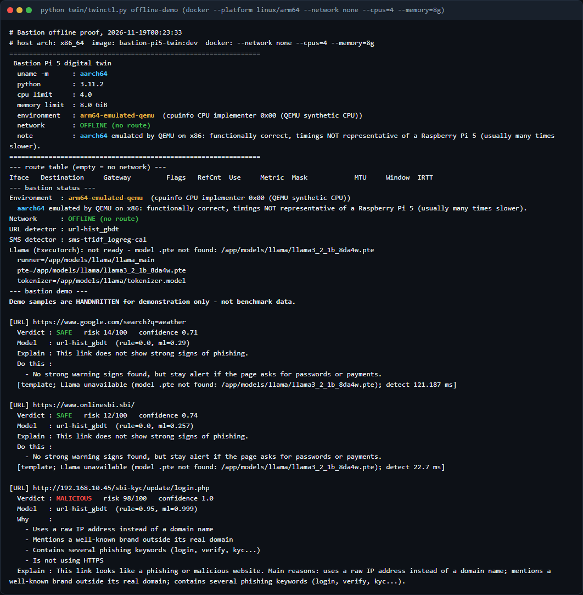

<details>
<summary>The full test suite running <b>inside</b> the aarch64 twin</summary>

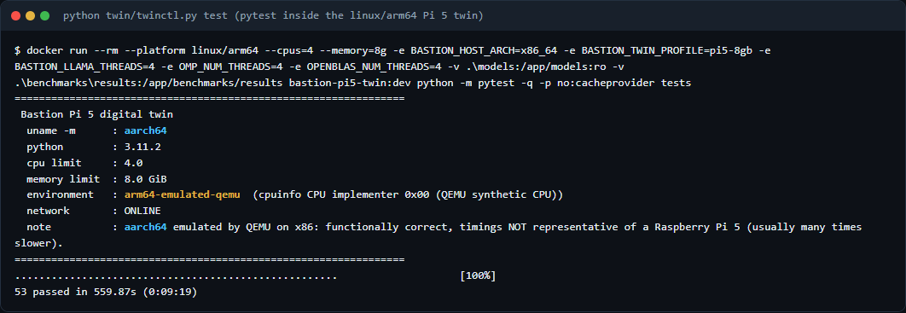
</details>

## 🏗️ How it works

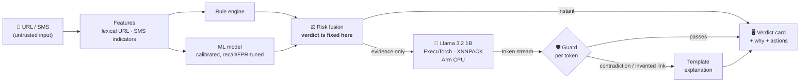

| Layer | What we built | Where |
|---|---|---|
| Detectors | 27 offline URL features + rules; SMS social-engineering indicators + TF-IDF model; links inside an SMS are scored by the URL detector | `src/bastion/features`, `detectors` |
| Fusion | ML probability aligned so the validated operating threshold lands exactly on the SUSPICIOUS boundary; rules can only add risk | `src/bastion/fusion/risk.py` |
| Explainer | Llama 3.2 1B Instruct → ExecuTorch `.pte` (8da4w, XNNPACK, KV cache). Loaded **once**, streamed token by token | `src/bastion/explain` |
| Safety | prompt-injection sanitising, `<data>` fencing, verdict lock, streaming guard, template fallback | `explain/prompts.py`, `explain/guard.py` |
| App | FastAPI + vanilla JS, SSE streaming, SQLite history (hash-only privacy mode), rate & size limits, localhost by default | `src/bastion/server.py`, `web/` |
| Twin | arm64 Docker image, Pi 5 profile, environment tagging, offline Compose, 3D dashboard | `twin/`, `src/bastion/env.py` |

## 📈 Results (every number has a JSON behind it)

**Accuracy: the deployed detector, end-to-end** (rules + ML + fusion) on held-out test data:

| Channel | Recall | Precision | False-positive rate | Extra check | Source |
|---|---|---|---|---|---|
| **SMS** (UCI SMS Spam, deduplicated) | **0.944** | **0.951** | **0.0066** | 1,028 test messages | [`sms_train_20261119_001008.json`](benchmarks/results/sms_train_20261119_001008.json) |
| **URL** (PhiUSIIL, domain-grouped split) | **0.737** | **0.983** | **0.016** | flags **2.6 %** of 10,000 popular real sites (Tranco) | [`url_train_20261119_000943.json`](benchmarks/results/url_train_20261119_000943.json) |

**Speed: per-scan detection latency (p50), tagged by environment:**

| Environment | URL | SMS | Source |
|---|---|---|---|
| `x86-native` (dev laptop) | 1.5 ms | 2.4 ms | `benchmarks/results/edge_x86-native_*.json` |
| `arm64-emulated-qemu` (Pi 5 twin on x86) | 26.8 ms | 68.2 ms | `benchmarks/results/edge_arm64-emulated-qemu_*.json` |
| `raspberry-pi-5` | *pending real hardware* | | |

> ⚠️ **Honesty rule.** Emulated timings prove the Arm software runs; they are **not** Raspberry Pi 5 timings (here
> emulation is ~18-29× slower than native x86). Every benchmark JSON and every UI metric carries its environment tag
> (`src/bastion/env.py`), and only `raspberry-pi-5` numbers are ever called Pi 5 performance.

## 🔬 What we found along the way (the interesting part)

<details open>
<summary><b>1. A "99 % accurate" URL model that would have flagged 99.5 % of the real web</b></summary>

PhiUSIIL's benign URLs are **100 % `https://www.` homepages**; phishing URLs are 41 % `www.`, 49 % https and 28 % have paths.
A model trained on it learns *collection habits*, not phishing, and our own test split carries the same artefacts, so it
looked perfect (FPR 0.025). We added an outside check, the false-positive rate on popular legitimate domains (Tranco), and
the "host" model flagged **99.5 %** of them (`github.com` → 1.00 phishing; `www.github.com` → 0.34).
Fix: the ML model sees the host **without scheme or `www.`**, tuned on validation for ≤ 2 % FPR. Now the two independent
benign sources agree (1.6 % vs 2.6 %). The price is honest: URL recall 0.737, not 0.95. Full story: [`docs/DATASETS.md`](docs/DATASETS.md).
</details>

<details>
<summary><b>2. A 0.95-recall threshold chosen from 37 examples gave a 16 % false-alarm rate</b></summary>

The SMS operating threshold was first picked on a validation half with only 37 scams; one odd message dragged it to 0.03.
Now it comes from 5-fold out-of-fold predictions over 422 scams: FPR 0.163 → **0.0066** at the same recall.
</details>

<details>
<summary><b>3. The twin caught real deployment bugs before we had a Pi</b></summary>

| Found in the arm64 twin | Fix |
|---|---|
| PyPI's aarch64 `torch` pulls **>1 GB of CUDA** libraries | `torch==2.15.0+cpu` from the PyTorch CPU index |
| ExecuTorch's PyPI wheel has **no Python LLM runner** | own decode loop over `executorch.runtime` (persistent, streaming) |
| Tokenizer needs `libatomic.so.1` | added to the image (present on Pi OS) |
| Thread pools sized to the host's 32 cores | `n_jobs=1`, `OMP_NUM_THREADS=4`, single-thread scoring: HistGBDT 6.2 → 1.4 ms |
| Model paths broke on non-editable installs | `BASTION_ROOT` |
</details>

## 🚀 Quick start (60 seconds)

```bash
git clone https://github.com/akshitag001/Bastion.git && cd Bastion
python -m venv .venv && source .venv/bin/activate     # Windows: .venv\Scripts\activate
pip install -r requirements.txt && pip install -e .
bastion serve                                         # → http://127.0.0.1:8080
```

```bash
bastion scan-sms "Your SBI account will be blocked today. Update KYC at http://sbi-kyc.xyz"
bastion scan-url "http://paypal.com.account-verify-secure.xyz/signin"
bastion demo            # handwritten demo samples (not benchmark data)
bastion status          # environment tag, network, models, Llama runtime
bastion serve --lan     # open it from your phone on the same Wi-Fi (no auth: trusted networks only)
bastion bench           # latency JSON, tagged with the environment
```

## 🍓 The Raspberry Pi 5 digital twin

The real aarch64 software stack (Debian Bookworm, Python 3.11.2, scikit-learn, ExecuTorch + XNNPACK) under the Pi 5's limits
(4 CPUs, 8 GB or 4 GB). On an x86 laptop it runs under QEMU; on Apple Silicon / Graviton it runs natively. [`docs/TWIN.md`](docs/TWIN.md)

```bash
python twin/twinctl.py setup          # checks Docker, buildx, arm64 support
python twin/twinctl.py build          # bastion-pi5-twin:dev (linux/arm64)
python twin/twinctl.py test           # pytest on aarch64
python twin/twinctl.py offline-demo   # --network none → benchmarks/results/offline_proof_<date>.log
python twin/twinctl.py bench          # tagged arm64-emulated-qemu on x86
docker compose up                     # the web app from the OFFLINE twin → http://127.0.0.1:8080
```

`docker compose` puts Bastion on an `internal` network with no gateway (it really cannot reach the internet), and a tiny
nginx proxy publishes the UI on your loopback interface only. Port taken? `BASTION_UI_PORT=8090 docker compose up`.

### On a real Raspberry Pi 5 (64-bit Raspberry Pi OS)

```bash
bash scripts/setup.sh                 # venv + torch 2.15.0+cpu + ExecuTorch 1.6.0 + pinned deps
source .venv/bin/activate && bastion status   # → environment: raspberry-pi-5
```

## 🧠 Llama 3.2 1B on ExecuTorch

**Working:** Llama 3.2 1B Instruct exported with **ExecuTorch 1.6.0** (8da4w, XNNPACK, KV cache), loaded once and kept
resident, streaming guarded explanations into the UI.

| Measured (`x86-native`, `edge_x86-native_20261123_182544.json`) | |
|---|---|
| model load (once) | 3.05 s |
| explanation, p50 | 4.29 s (verdict is instant; the explanation streams afterwards) |
| decode | 35.25 tokens/s |
| guard fallbacks | 1 of 5: the prompt-injection SMS, rejected mid-stream, verdict unchanged |

Export it yourself (Windows/Linux/macOS, no Docker needed):
```bash
# weights: Meta's original checkpoint (needs licence approval) or a Hugging Face snapshot of Llama-3.2-1B-Instruct
python twin/export/export_local.py --hf-dir models/llama/<hf-snapshot>     # or --meta-dir <folder with consolidated.00.pth>
bastion status    # -> Llama (ExecuTorch): READY, ok (runtime backend)
```
Container route: `python twin/twinctl.py export` (needs `HF_TOKEN` and approved access). The weights are not in this
repository. Details, versions and findings (including why the 2024 pre-exported `.pte` fails on the 1.6.0 runtime):
[`docs/EXECUTORCH_NOTES.md`](docs/EXECUTORCH_NOTES.md).

## 🔒 Privacy & security

- **Offline by design:** no external calls at runtime, all frontend assets (incl. three.js) vendored; tested.
- History lives in a local SQLite file; **privacy mode** stores only SHA-256 hashes; one-click clear.
- Untrusted text is rendered with `textContent` only; inputs size-limited (URL 2,048 / SMS 2,000 chars) and rate-limited.
- Server binds `127.0.0.1` by default; the app loads models only from its own `models/` folder; no `shell=True`.

## 🗂️ Repository

```
src/bastion/          features · detectors · fusion · explain (Llama, guard) · advice · server · env · web UI
training/             trainers: validation-only selection, calibration, operating points, end-to-end eval
benchmarks/results/   every number in this README (JSON + logs); archive/ = superseded runs cited in docs
twin/                 arm64 Dockerfile, Pi 5 profile, twinctl, export container, nginx
docs/                 Final Project Report (PDF) · REPORT · DATASETS · TWIN · EXECUTORCH_NOTES · PROGRESS · screenshots
tests/                53 tests: features, detectors, guard, injection, Llama backends, API, UI, training
```

## ⚠️ Limitations (and the Phase 2 plan)

- **No real Pi 5 numbers yet.** The twin proves correctness on aarch64 and offline operation, not Pi 5 speed.
- **URL recall is 0.737** at a 2 % false-alarm budget: lexical offline features can't do better on this data.
  Phase 2: an on-device phishing blocklist snapshot (Safe-Browsing-style), opt-in page-content features, better benign data.
- **SMS data is dated and mostly UK English;** Indian UPI/KYC/courier scams are under-represented. Phase 2: an Indian test set.
- Llama is measured on x86 only so far; the run inside the arm64 twin and on a real Pi 5 is next.
- A 1B model writes short, sometimes generic explanations; the detector's "why" list carries the specific evidence.

## 📜 Data & credits

UCI SMS Spam Collection and PhiUSIIL Phishing URL Dataset (CC BY 4.0) · Tranco list (evaluation only) ·
Llama 3.2 (Meta, Llama 3.2 Community License) · ExecuTorch & PyTorch (BSD) · three.js (MIT, vendored) · FastAPI, scikit-learn.
The 3D board is drawn from simple shapes; no Raspberry Pi logos or product images are used.
